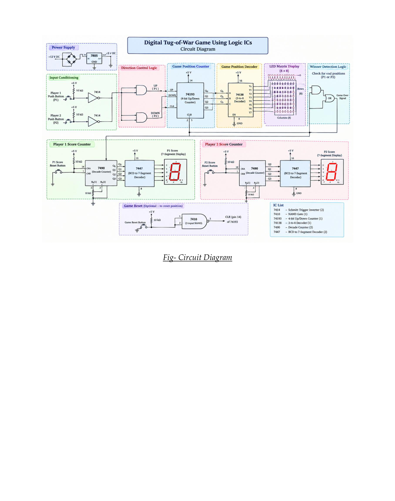
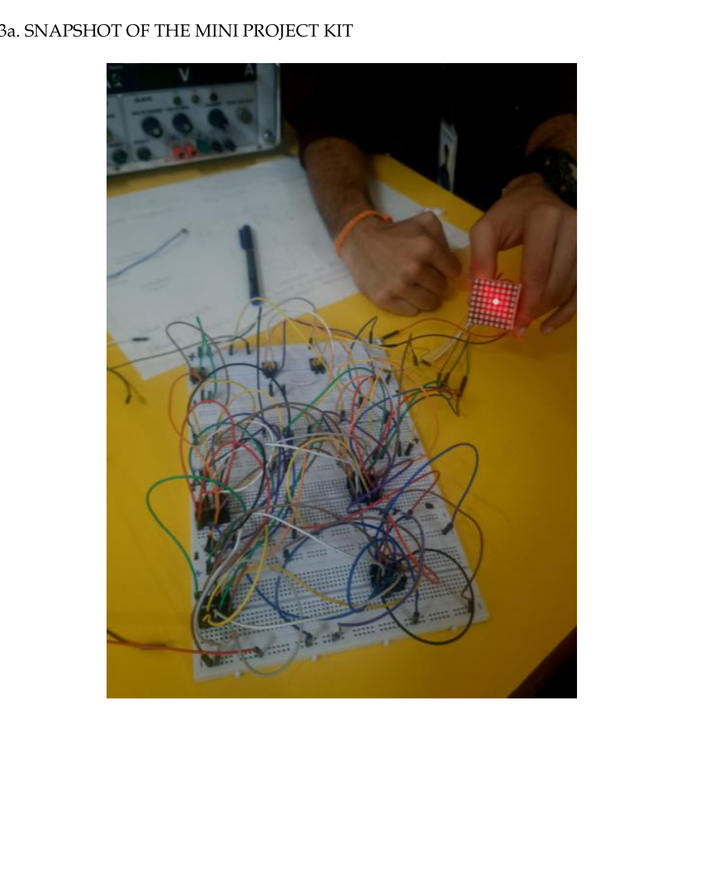

# Digital Tug-of-War Game Using Logic ICs

## Project Overview
A two-player Digital Tug-of-War Game designed and implemented using 74xx series logic integrated circuits.

The system simulates a traditional tug-of-war competition using push buttons, digital counters and an LED matrix. Each player's button press moves the game indicator towards their side. The first player to reach the winning position wins the round.

## Objectives
- Design a two-player digital game using logic ICs.
- Understand the practical applications of digital counters, decoders and logic gates.
- Implement player input processing and game-position control.
- Detect winning conditions using digital logic.
- Display player scores using 7-segment displays.

## Components Used
- 7414 Schmitt Trigger Inverter
- 74193 Up/Down Counter
- 74138 Decoder
- 7408 AND Gate
- 7432 OR Gate
- 7486 XOR Gate
- 7490 Decade Counter
- 7447 BCD-to-7-Segment Decoder
- 8×8 LED Matrix
- 7-Segment Displays
- Push Buttons
- Resistors, capacitors and connecting wires

## Working Principle
1. Two players provide inputs using separate push buttons.
2. The 7414 IC conditions the input signals.
3. The 74193 counter tracks the current game position.
4. The 74138 decoder converts the counter output into decoded signals.
5. The LED matrix indicates the current game position.
6. Winner detection logic identifies when a player reaches the winning position.
7. The 7490 counter records the scores.
8. The 7447 decoder drives the 7-segment displays to show the scores.

## Hardware Implementation
The project was implemented using logic ICs on a breadboard with a regulated +5V DC power supply. No microcontroller or software programming was used.

## Applications and Learning Outcomes
- Practical implementation of digital logic concepts.
- Understanding counter and decoder interfacing.
- Sequential circuit applications.
- Digital display interfacing.
- Hardware circuit design and troubleshooting.
- ## Project Gallery

### Circuit Diagram

### Hardware Implementation

## Technologies and Concepts
Digital Electronics | Logic ICs | Counters | Decoders | Sequential Logic | LED Matrix | 7-Segment Display

## Project Type
Academic Group Project – Electronics and Communication Engineering
